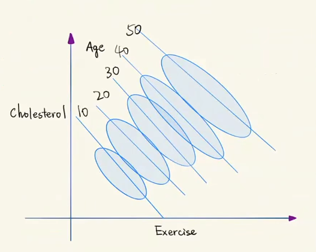
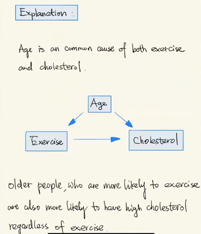
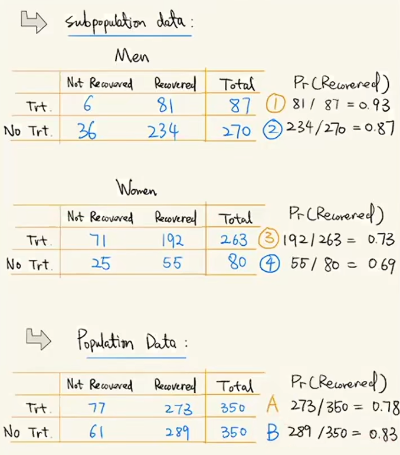
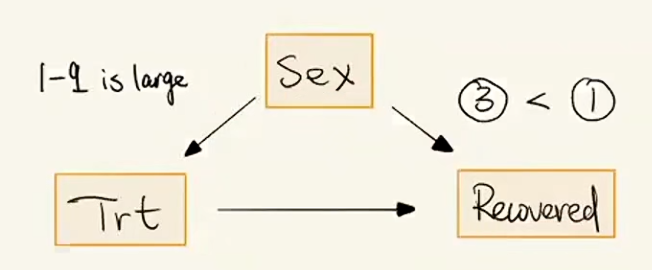
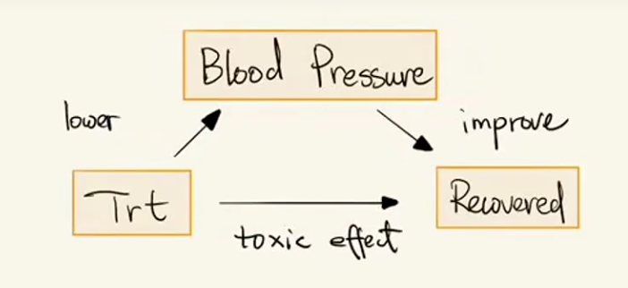
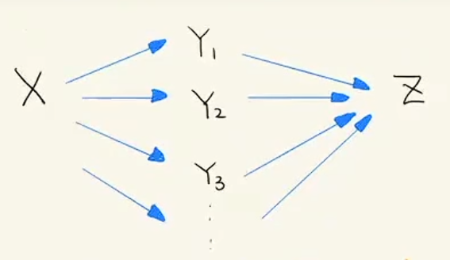
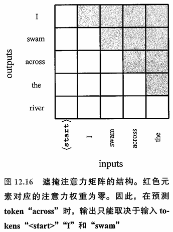

# 因果推断

## 辛普森悖论

### 例子 1

如图：

图中横轴为运动量纵轴为胆固醇含量，每个圈是特定年龄段的人的运动量和胆固醇含量的主要分布情况。

可以知道年龄相同，运动量越多胆固醇越少，但如果没有年龄数据，会得到运动量越多胆固醇越多的结论。

产生这种情况的原因是，年龄同时是运动量和胆固醇含量的因变量：

此时关注分类数据（按年龄分开）更为合理。

### 例子 2

图中 trt. 意思是吃某种药，recovered 意思是恢复。将男性吃药、不吃药恢复率（恢复人数除以总人数）分别记为 $①$ 和 $②$，女性的记为 $③$ 和 $④$，总体的（各人数分别相加）记为 $A$ 和 $B$。

“悖论”的地方在于，图中虽然 $① > ②$，$③ > ④$，但是 $A < B$。

我们用概率论来分析这个问题。设三个二值的随机变量 $\mathrm g, \mathrm r, \mathrm t \in \{0, 1\}$，分别代表是否是男生、是否恢复以及是否吃药。得到：

$$
① = p(\mathrm r = 1 \mid \mathrm g = 1, \mathrm t = 1)\\
② = p(\mathrm r = 1 \mid \mathrm g = 1, \mathrm t = 0)\\
③ = p(\mathrm r = 1 \mid \mathrm g = 0, \mathrm t = 1)\\
④ = p(\mathrm r = 1 \mid \mathrm g = 0, \mathrm t = 0)\\
$$

用边缘概率公式展开 $A$、$B$：

$$
\begin{aligned}
A &= p(\mathrm r = 1 \mid \mathrm t = 1)\\
&= p(\mathrm r = 1 \mid \mathrm t = 1, \mathrm g = 0) p(\mathrm g = 0 \mid \mathrm t = 1)\\
&+ p(\mathrm r = 1 \mid \mathrm t = 1, \mathrm g = 1) p(\mathrm g = 1 \mid \mathrm t = 1)\\
B &= \dots
\end{aligned}
$$

设 $p(\mathrm g = 1 \mid \mathrm t = 1)$ 为 $r$，$p(\mathrm g = 1 \mid \mathrm t = 0)$ 为 $s$，得到：

$$
A = r① + (1-r)③\\
B = s② + (1-s)④\\
$$

由于 $r$ 和 $s$ 可以在 0 到 1 内任意取值，所以即使 $① > ②$，$③ > ④$，还是有可能有 $A < B$（比如令 $③ < ②$，$r \approx 0$，$s \approx 1$）。

这里的因果关系和胆固醇那个例子结构一样：

### 例子 3

这里吃的药会对人体有点毒性（图里的 toxic effect）从而减小恢复概率，但同时会降低血压，以增大恢复概率。

此时看分类数据 $p(\dots \mid \text{低血压})$，由于此时样本的血压差不多，所以药物通过血压对恢复起的积极作用就被剔除了，导致结论是吃药的恢复率不如不吃药的。

所以这里应该看总体数据。

### 总结

这三个例子都只有三个变量，但我们用传统的概率论知识来分析还是有点费劲。因果推断有系统的方法解决这些问题。

## 统计相关性和因果性

统计相关性不意味着因果性，而因果性大部分情况都代表着统计相关性。

有因果性但没相关性的例子：人体有 A、B 两种疾病，它们要么同时出现要么同时不出现。A 会生成某种东西导致癌症，而 B 能消解 A 的效应防止癌症。那么这样 A 确实会导致癌症（因果性），但由于 B 的存在，A 的存在和患癌没有统计相关性。

## 基本结构

### 链式结构

因果图：

$$
\mathrm x \to \mathrm y \to \mathrm z
$$

这里其实并不是完整的图，我们还假设每个随机变量都有一个额外的父节点，这些节点称为噪声（外生变量，这里的 $\mathrm x$、$\mathrm y$、$\mathrm z$ 称为内生变量），所有噪声联合独立。

这里有条件独立：$\mathrm x \perp \mathrm z \mid \mathrm y$。

#### 阻断的解释

可以根据因果图来解释：由于 $\mathrm x$ 只能通过 $\mathrm y$ 来影响 $\mathrm z$，而现在 $\mathrm y$ 已经固定（观测到），无法改变，所以说路径 $\mathrm y \to \mathrm z$ 就被**阻断**了，于是独立。

注意这里观测到 $\mathrm y$ 时，

或者这样解释：$\mathrm y$ 被固定后，$\mathrm y$ 给出了 $\mathrm z$ 对于 $\mathrm x$ 需要的所有信息。

#### 独立性证明

设三个变量对应的噪声分别是 $\mathrm u^\mathrm x$、$\mathrm u^\mathrm y$、$\mathrm u^\mathrm z$。

我们需要用 SCM（结构因果模型）的定义：每个随机变量就是噪声的取值和父节点的取值输入进某个函数得到。

比如这里有：

$$
\mathrm y \overset{\text{def}}= f^\mathrm y(\mathrm u^\mathrm y = u^\mathrm y, \mathrm x = x)
$$

我们又说**所有噪声联合独立**，那么 $\mathrm u^\mathrm z \perp \{\mathrm u^\mathrm x, \mathrm u^\mathrm y\}$。

> **待补充**：完整证明。

这里还可以推导出下面贝叶斯网络的联合分布分解。

#### 有多个 $\mathrm y$ 的情况

这里有 $\mathrm X \perp \mathrm Z \mid \{\mathrm Y_1, \mathrm Y_2, \mathrm Y_3, \dots\}$。

#### 例子

回顾辛普森悖论的例子 3，如果固定血压，那么血药促进的恢复效果 $\text{Blood Pressure} \to \text{Recovered}$ 就被阻塞，于是只剩下药物本身对恢复的抑制作用。

### 分叉结构

$$
\mathrm y \leftarrow \mathrm x \to \mathrm z
$$

有 $\mathrm y \perp \mathrm z \mid \mathrm x$，两条路径都被阻断。

再来看辛普森悖论的例子 1，这里年龄同时影响了胆固醇和运动量，为了去掉它的影响，我们固定年龄，这样就只有运动量到胆固醇这条边了。$\text{Exercise} \leftarrow \text{Age} \to \text{Cholesterol}$ 这条边并没因果性，我们固定年龄，可以去掉这条通路产生的相关性，这样就更为客观。

或者这样，如果我们并不知道运动量和胆固醇含量有没有因果性，但是知道运动量会同时控制两者，这样显然先切断我们知道的这个相关性更合理。

### 对撞结构

$$
\mathrm x \to \mathrm z \leftarrow \mathrm y
$$

这里有 $\mathrm x \perp \mathrm y$ 以及 $\mathrm x \not\perp \mathrm y \mid \mathrm z$。

比如：

$$
\mathrm x = \mathrm u^\mathrm x\\
\mathrm y = \mathrm u^\mathrm y\\
\mathrm z = \mathrm x + \mathrm y + \mathrm u^\mathrm z
$$

当观测到 $\mathrm z = C$ 后，剩下的两个需要满足约束 $\mathrm x + \mathrm y = C - \mathrm u^\mathrm z$，于是条件不独立（不一定相关，之前有说反例）。

## D-分离

这里的 D 是指 directional。

$\mathrm x$ 和 $\mathrm y$ 被 D-分离指的是 $\mathrm x$ 到 $\mathrm y$ 的所有路径都被阻断。

否则就是 D-连通，这等价于存在一条连通的路径。

> 学习进度：《基础与概念》第 286 页，《因果推断入门》E 12，7:59

# 变分推断

## 问题

我们想根据数据 $\bm x$ 更新参数 $\bm z$，根据贝叶斯公式：

$$
\overbrace{p(\mathbf z \mid \mathbf x)}^\text{posterior} = \frac{
   \overbrace{p(\mathbf x \mid \mathbf z)}^\text{likelihood} \,
   \overbrace{p(\mathbf z)}^\text{prior}
}{
   \underbrace{p(\mathbf x)}_\text{evidence}
}
$$

# 概率图模型（结构化概率模型）

有向图适用于表达随机变量间的因果关系，而无向图更适合表达随机变量之间的软约束。

## 贝叶斯网络（有向图模型）

给出有 $N$ 个顶点的有向无环图 $\mathcal G$，每个节点视作一个随机变量 $\mathrm x_i$，节点的父节点集合记为 $\operatorname{Pa}_\mathcal{G}(\mathrm x_i)$。$\mathcal G$ 表示的联合概率分布为：

$$
p(\mathrm{x}_1, \dots, \mathrm{x}_N) = \prod_i p(\mathrm{x}_i \mid \operatorname{Pa}_\mathcal{G}(\mathrm{x}_i))
$$

比如：

$$
p(\mathrm a, \dots, \mathrm e) = p(\mathrm a) + p(\mathrm b \mid \mathrm a) + p(\mathrm c \mid \mathrm a, \mathrm b) + p(\mathrm d \mid \mathrm b) + p(\mathrm e \mid \mathrm c)
$$

条件概率分布可以使用高斯分布：

$$
p(\mathbf{x}_i = \bm{x} \mid \operatorname{Pa}(\mathbf{x}_i)) = \mathcal{N}(
   \bm x;
   (
      \sum_{j \in \operatorname{Pa}(\mathbf{x}_i)}
      \bm W_{i, j} \bm x_j + \bm b_i
   ),
   \bm\Sigma_i
)
$$

其中 $j$ 是父节点的索引（这里记法不是很严谨），$\bm W_{i, j}$ 是一个矩阵（可能不是方阵）。

# Transformer

优势：

* 迁移学习效果显著，所以可以先用通用数据训练（GPT 的 P，**预训练**），得到基础模型，然后在特定任务上**微调**；
* 可以用**无标签的数据**以**自监督**方式进行训练，这意味着无需人工标注数据，可以直接使用互联网或其他地方的海量数据；
* 可以并行化，利用 GPU 等设备来训练。

Transformer 层输入一个数据矩阵 $\bm X$，并输出一个**形状相同**的矩阵 $\bm Y = \operatorname{TransformerLayer}[\bm X]$。对于输入 $N$（`sequence_length`）个 token，token 向量维数为 $D$（`d_model`）的层，有 $\bm X \in \mathbb R^{N \times D}$，第 $i$ 个 token 向量为 $\bm x^{(i)} = \bm X_{i, :}^\top$。

token 向量所在的空间（嵌入空间）每个方向都有特定的语义。对于 NLP，需要先给出分词算法（得到 token 集合），然后给出一个神经网络，它需要训练出 token 和嵌入向量的映射，它不需要预训练，直接初始化参数同 Transformer 一块开始训练。

输入输出形状相同，于是可以叠加多个 Transformer 层（不共享参数）来让模型的内部表示更丰富。

Transformer 层主要来说包含两个阶段：

1. 应用注意力。将某个表示空间的一组向量转换到**另一个**嵌入空间中具有相同维度的一组向量。NLP 中就是就是将词本身的含义转换为词在句中的含义。
2. 前馈层。将每个用注意力更新过后的 token 向量输入进一个全连接层，每个向量这里独立地执行相同的操作。可以认为是对每个嵌入向量问一组问题，比如问这个 token 是不是代词。

## 注意力

> 这里基本理解跳过

先拿以前的电影推荐算法类比。它首先对每个电影（**值**）给出一个向量（**键**），每个分类代表不同维度打分（比如是否是戏剧，恐怖的程度），然后统计用户的喜好，也是同维度且每个维度含义相同的向量（**查询**）。推荐时计算用户的向量和各个电影的向量的相似度，然后对用户推荐相似度较高的几个电影。

这里的值是离散的，在 Transformer 中，我们为了方便梯度下降，需要避免这种称为硬注意力的离散化方法，而是使用让值变得连续，方便梯度下降的软注意力方法。这时**模型原始的输出是个嵌入向量**，模型推理时，则需要找到所有 token 中嵌入离输出较近的那几个（这个根据嵌入找 token 的过程称为向量搜索）。

### 自注意力推导

#### 注意力系数对称，无参数

一开始，我们想让输出向量 $\bm y^{(n)} = \bm Y_{n, :}$ 是输入 $\bm x^{(1)}, \dots, \bm x^{(n)}$ 的凸组合（这里的凸组合系数称为注意力系数）：

$$
\bm y^{(n)} = \sum_{i=1}^N A_{n, i} \bm x^{(i)}\\
\sum_i A_{n, i} = 1\\
\forall i, A_{n, i} \ge 0
$$

凸组合目的是让 $\lVert \bm y^{(n)} \rVert$ 与 $N$ 解耦。

直接把 $\bm A$ 当参数显然不合适，我们先不加参数，直接计算得到注意力系数。

$A_{n, i}$ 衡量 $\bm x^{(i)}$ 的含义**对** $\bm x^{(n)}$ 的影响，我们先舍弃不对称性，并简单地让 $A_{n, i} = {\bm x^{(i)}}^\top \bm x^{(n)}$，省略约束条件，并变回数据矩阵的形式：

$$
\begin{aligned}
\bm Y_{n, :} &= \sum_{i=1}^N A_{n, i} \bm x^{(i)}\\
&= \sum_{i=1}^N \left({\bm x^{(i)}}^\top \bm x^{(n)}\right) \bm x^{(i)}\\
&= \sum_{i=1}^N \left({\bm X_{i, :}} \bm X_{n, :}^\top\right) \bm X_{i, :}^\top\\
\bm S &= \bm X \bm X^\top\\
\bm Y &= \bm S \bm X
\end{aligned}
$$

这里 $\bm A$ 每行都需要满足刚才的约束。我们对 $\bm S$ 每行都应用一个 softmax 函数：

$$
\bm A_{n, :} = \operatorname{softmax} \bm S_{n, :}\\
\bm A = \operatorname*{Softmax}_\text{对每行} \bm S \in \mathbb R^{N \times N}
$$

于是之前的公式就改成了简洁的矩阵乘法：

$$
\bm Y = \operatorname{Softmax}(\bm X \bm X^\top) \bm X
$$

这里使用 softmax 并没有概率上的意义，选 softmax 是因为它计算方便，还可以拉大系数间的差距。

#### 加入参数

我们这里还没有可学习的参数。我们加入一个参数矩阵 $\bm U \in \mathbb R^{D \times D}$。我们把所有的输入向量进行变换后再计算点积：

$$
\tilde{\bm X} = \bm X \bm U \in \mathbb R^{N \times D}\\
\bm Y = \operatorname{Softmax}(\tilde{\bm X} \tilde{\bm X}^\top) \tilde{\bm X}
$$

#### 引入 Q、K、V

之前我们说先舍弃不对称性，于是导致 $\tilde{\bm X} \tilde{\bm X}^\top$ 是对称矩阵，虽然有 softmax 破坏对称性，但我们更希望查询、键和值参数独立分工来让模型更灵活，顺便引入不对称性。

现在公式有三个 $\tilde{\bm X}$，我们把它们变成不同的三个矩阵。给出三个参数：

$$
\bm W^q \in \mathbb R^{D \times D_q}\\
\bm W^k \in \mathbb R^{D \times D_k}\\
\bm W^v \in \mathbb R^{D \times D_v}
$$

式子变为：

$$
\bm Q = \bm X \bm W^q \in \mathbb R^{N \times D_q}\\
\bm K = \bm X \bm W^k \in \mathbb R^{N \times D_k}\\
\bm V = \bm X \bm W^v \in \mathbb R^{N \times D_v}\\
\bm Y = \operatorname{Softmax}(\bm Q \bm K^\top) \bm V \in \mathbb R^{N \times D_v}
$$

为了能进行括号内的矩阵乘法，必须要有 $D_q = D_k$。

这里相当于用 $\bm W^q$、$\bm W^k$ 变换后的输入点积乘以用 $\bm W^v$ 变换后的输入。

[GPT-3](https://arxiv.org/abs/2005.14165) 中，$D_k$ 比 $D$ 小很多，$D = D_v = 12288$，$D_q = D_k = 128$。

#### 注意力系数的方差问题

> 完整推导见 [另一个文件](scaled-self-attention-var.md)

由于方差包含 $D_k$，需要把它去掉，否则会导致 softmax 饱和（输出接近独热向量），所以我们乘上一个系数让它方差里的 $D_k$ 系数消失，得到自注意力的最终形式：

$$
\operatorname{Attention}(\bm Q, \bm K, \bm V) \overset{\text{def}}= \operatorname*{Softmax}_\text{对每行}(\frac{\bm Q \bm K^\top}{\sqrt{D_k}}) \bm V\\
\bm Y = \operatorname{Attention}(\bm Q, \bm K, \bm V)
$$

### 多头注意力

为了增强模型的表达能力，我们想让一个自注意层（注意力头）只学习一种模式，使用 $H$ 个注意力头，第 $i$ 个头有自己的参数，我们对每个头计算 $\text{head}_i = \operatorname{Attention}(\bm Q^{(i)}, \bm K^{(i)}, \bm V^{(i)})$，然后在特征方向拼接所有头的输出，再乘一个 $(H D_v) \times D$ 的矩阵 $\bm W^o$：

$$
\operatorname{MultiHead}(\bm X) \overset{\text{def}}= \operatorname*{Concat}_\text{横向}(\text{head}_1, \dots, \text{head}_H) \bm W^o
$$

## 残差、归一化和前馈层

残差网络能够轻松学到恒等映射，让训练更容易。Transformer 层中将多头注意力的输出加上原始输入，然后进行层归一化：

$$
\bm Z = \operatorname{MultiHead}(\bm X + \operatorname{LayerNorm}(\bm X))
$$

这种形式叫 Post-Norm，下面的是现在更常用的 Pre-Norm（预归一化）形式：

$$
\bm Z = \bm X + \operatorname{LayerNorm}(\operatorname{MultiHead}(\bm X))
$$

后者更加稳定，因为把前馈层或多头注意力的输入进行了归一化。同时，因为没有改变 $\bm x$ 项，从而让雅可比变成 $\bm I + \dots$ 的连乘从而方便训练。

把 $\bm Z \in \mathbb R^{N \times D}$ 的每行用一个多层感知机变换：

$$
\text{Linear} \to \text{ReLU} \to \text{Linear}
$$

即

$$
\operatorname{FFN}(\bm x) = \max_\text{逐元素}(0, \bm x \bm W^{(1)} + \bm b^{(1)}) \bm W^{(2)} + \bm b^{(2)}
$$

其中第一个（括号内的）线性变换将 $D$ 维输入向量变为 $D_\text{ff}$（GPT-3 中 $D_\text{ff} = 4 \cdot D$），另一个线性变换将向量维度又变为 $D$。

最后一步再进行残差和归一化，得到最终结果（这里是 Pre-Norm）：

$$
\tilde{\bm X} = \bm Z + \operatorname*{FFN}_\text{对每行}(\operatorname{LayerNorm}(\bm Z))
$$

可以把上面的两个层归一化换成 RMSNorm（均方根归一化），在减少计算量和参数量的情况下效果与层归一化相当。

### 层归一化和 RMSNorm 的过程

层归一化 $\operatorname{LayerNorm}: \mathbb R^{N \times D} \to \mathbb R^{N \times D}$ 计算每个特征维度的均值方差：

$$
\begin{aligned}
& \bm\mu = \frac 1 D \sum_{i=1}^D \bm X_{i, :}\\
& \sigma_i = \sqrt{\delta + \frac 1 D \sum_{j=1}^D (X_{j, i} - \mu_i)^2}\\
& \bm X' = \frac{\bm X - \bm\mu}{\bm\sigma}\\
& \bm\gamma, \bm\beta \in \mathbb R^{D}\\
& \operatorname{LayerNorm}(\bm X) = \bm\gamma \odot \bm X' + \bm\beta
\end{aligned}
$$

其中参数是 $\bm\gamma$ 和 $\bm\beta$，对不同特征维度进行不同缩放，通常初始化为 $\bm\gamma = \bm1$，$\bm\beta = \bm0$。最后一行发生了广播。

RMSNorm 去掉了其中的平移操作，只留下缩放：

$$
\begin{aligned}
& \operatorname{RMS}(\bm X)_i = \sqrt{\delta + \frac 1 D \sum_{j=1}^D X_{j, i}^2}\\
& \operatorname{RMSNorm}(\bm X) = \bm\gamma \frac{\bm X}{\operatorname{RMS}(\bm X)} && \text{(广播，除法逐元素)}
\end{aligned}
$$

### 为什么是 RMSNorm？

先说为什么不是批归一化：它没有意义。训练时输入的张量形状是 $(B, N, D)$（$B$ 是 batch size），训练时的输入中输入每个序列一般不是同一个句子，不同句子的同一位置的分布显然大概率是不同的，所以批归一化的求和方向没有意义。

而残差流 $\bm X + \bm F(\bm X)$ 让注意力和前馈层只需学习加在 $\bm X$ 上的增量，所以均值相对稳定，不是很有必要处理均值。

## 纯解码 Transformer

输入前 $n-1$ 个 token，预测第 $n$ 个 token，或者说预测条件概率 $p(\bm x^{(n)} \mid \bm x^{(1)}, \dots, \bm x^{(n-1)})$ 然后采样。

GPT 等 LLM 就是通过这种方法自回归地生成句子，也就是常说的 predict next token 模式。

结构：

1. 将输入的 token 序列查表（或者说词嵌入矩阵 $\bm E \in \mathbb R^{V \times D}$ 乘上 token 的独热向量，词嵌入矩阵作为参数参与训练）得到嵌入矩阵 $\bm X \in \mathbb R^{N \times D}$。
2. 位置编码。
3. 输入进堆叠了 $L$ 层的 Transformer 层，其中多头注意力带因果掩码。
4. 一个 RMSNorm 层。
5. 输入进 LM-head（语言模型头），这是一个线性层，对上一步的输出 $\tilde{\bm X}$ 每行都进行操作 $\bm x \mapsto \bm W_\text{lm} \bm x + \bm b_\text{lm} \in \mathbb R^V$，得到 logits 矩阵。一般这里有参数共享 $\bm W_\text{lm} = \bm E$，可以再对每行 softmax 得到概率分布。

我们在训练时想让位置 $i$ 关注它前面的所有嵌入，然后来预测 $i+1$ 个 token 的嵌入。这样对输入的单个样本，可以同时学习所有位置的下个 token 的条件概率分布。

在推理时，输出的 logits 矩阵的最后一行作为下一个 token 的分布预测。

为了让首个嵌入也能训练，我们往词表加入名为 `BOS`（begin of sequence，或者叫 `<start>`）的特殊 token。于是训练时，输入是 $(\text{BOS}, \bm x^{(1)}, \dots, \bm x^{(N-1)})$，期望的输出为 $(\bm x^{(1)}, \dots, \bm x^{(N)})$，这就是 RNN 中的导师驱动过程。

因果掩码将方阵 $\bm A = \bm Q \bm K^\top$ 的上三角部分（图中黑色部分）设为 $-\infin$ 来实现只关注前面的嵌入向量。由于要将 $\bm A$ 每行 softmax，因为 $\exp(-\infin) = 0$，所以这相当于只对当前位置前面的注意力系数进行 softmax。于是得到带因果掩码的自注意力：

$$
\operatorname*{Attention}_\text{masked}(\bm Q, \bm K, \bm V) = \operatorname{Softmax}(\frac{\bm Q \bm K^\top}{\sqrt{D_k}} + \bm M) \bm V\\
$$

其中 $\bm M$ 上三角部分为 $-\infin$，其余元素为 $0$。

> **待补充**: `PAD` token

# 位置编码

Transformer 层对 token 序列排列等变，所以我们把输入进行位置编码来引入顺序信息。

## *Attention Is All You Need* 中的位置编码

原文的位置编码计算矩阵 $\bm P \in \mathbb R^{N \times D}$ 并加到输入 $\bm X$ 上（逐元素相加）得到结果 $\tilde{\bm X} = \bm X + \bm P$。

我们定义

$$
\begin{cases}
P_{t, 2i} &= \sin(t/L^{2i/D}) & \text{(即当特征维度索引是偶数)}\\
P_{t, 2i+1} &= \cos(t/L^{2i/D}) & \text{(即当特征维度索引是奇数)}
\end{cases}
$$
